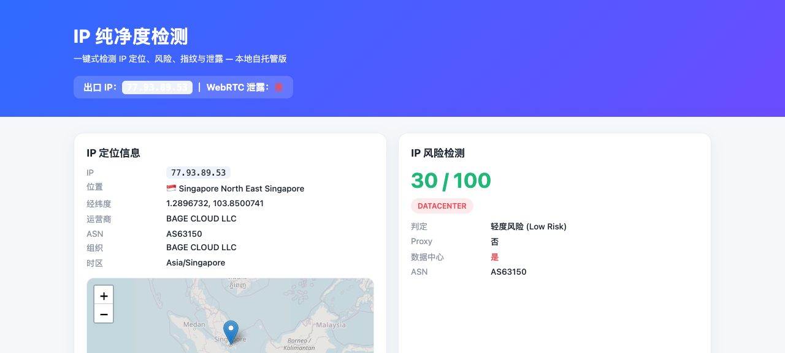

# IP 纯净度检测 · IP Purity Check

> 一个**本地自托管**的「IP 纯净度检测」工具：检测你的出口 IP、地理位置、运营商 / ASN、风险（代理 / 数据中心 / VPN）、WebRTC 泄露、浏览器指纹、出口一致性与 DNS 泄露。
>
> **零依赖**（Node 内置 `http` + 全局 `fetch`），全部使用**免费、无需密钥**的公开数据源，开箱即用。
>
> **完全独立、无作者后端**：本工具不依赖任何作者托管的后端服务，部署即完全独立运行。所有 IP 地理 / 风险富集均通过免费公开第三方 API（`ipwho.is` / `ip-api.com` / `api.ipify.org`）完成；作者不收集、不存储、也看不到任何部署实例的数据。



---

## ⚠️ 风险提示与免责声明（请先读）

本项目仅用于**个人网络安全自查、教育与研究**。使用前请务必了解以下风险与边界：

1. **它会读取并记录 IP。** 工具的「服务端」会读取访问者的出口 IP（`X-Forwarded-For` / `X-Real-IP`）与请求头（User-Agent、Accept-Language）。**不要在你不信任的服务器上部署**，也不要把部署后的公开链接随意发给他人——访客的 IP 会出现在你的服务端日志 / 响应里。
2. **第三方数据源有准确性与隐私边界。** 地理定位、ASN、风险标记来自 `ipwho.is` 与 `ip-api.com` 等免费公共服务，数据基于公开的 IP 库，**可能存在误差、延迟或覆盖范围缺口**，结果仅供参考，不构成权威判定。免费服务也有速率限制与隐私条款，请自行阅读其政策。
3. **风险评分是启发式，不是权威黑名单。** `score` 与 `verdict`（Proxy / Datacenter / VPN_LIKELY）由本项目的简单规则推导，**不等于** AbuseIPDB / Scamalytics 等商业威胁情报的判定，误报 / 漏报都可能发生。
4. **WebRTC / 指纹为浏览器端实测。** 检测在你的浏览器本地运行，结果受浏览器隐私设置、插件、禁用 WebRTC 等影响；它只能发现"浏览器是否暴露了额外 IP"，不能保证 100% 覆盖所有泄露路径。
5. **DNS 泄露为近似指标。** 严格意义上的 DNS 泄露检测需要自有域名记录各解析器出口。本工具用「多出口回显一致性」近似，**不能替代**专业 DNS-Leak-Test 服务。
6. **仅限合法用途。** 禁止将本项目用于未经授权的追踪、人肉搜索、骚扰或任何违反法律法规与平台条款的行为。因滥用本项目产生的一切后果由使用者自行承担，作者与贡献者不承担任何责任。
7. **部署到公网后更强也更易暴露。** 公网部署时服务端读到的是访客真实出口 IP，泄露检测更权威；但同样意味着你的服务器会处理陌生人的请求，请做好访问控制与日志管理。

---

## 它能做什么

| 模块 | 说明 | 数据来源 |
|------|------|----------|
| IP 定位 | 国家 / 省 / 市、经纬度、运营商、ASN、时区（含地图） | `ipwho.is` |
| IP 风险 | 风险分 (0–100) + 判定 + 标记（Proxy / Datacenter / VPN_LIKELY） | `ip-api.com` + 启发式规则 |
| WebRTC 泄露 | `RTCPeerConnection` + STUN 提取 ICE 候选里的真实 IP | 浏览器端实测（标准 STUN 候选采集） |
| 浏览器指纹 | 设备 / 浏览器稳定指纹哈希 | FingerprintJS v3（CDN） |
| 出口一致性 | 服务端 IP vs 浏览器出口 IP vs WebRTC IP 三方比对 | 本工具服务 + 浏览器端 |
| DNS 泄露 | 多出口回显源一致性近似指标 | `api.ipify.org` 等多源 |

---

## 它是怎么工作的（实现原理）

本工具由两部分组成：

- **服务端检测** → 「服务端」读取访问者的出口 IP（`X-Forwarded-For` / `X-Real-IP`）并调用免费公开 API 做地理 / ASN / ISP / 风险富集：`ipwho.is`（地理 / ASN / ISP / 时区）+ `ip-api.com`（proxy / hosting / mobile 风险标记）。
- **浏览器端检测** → 在你的浏览器本地运行：WebRTC 泄露（`RTCPeerConnection` + STUN 提取 ICE 候选里的真实 IP）、FingerprintJS 指纹、出口一致性对比。
- **关键**：真正"监测出真实出口 IP"的价值来自**服务端读取请求 IP**。本地访问时为 `127.0.0.1`，因此前端用 `api.ipify.org` 自发现出口 IP；**部署到公网后**，服务端读取的即是访客真实出口 IP。`/api/echo` 已预留该能力。

---

## 本地运行

```bash
# 需要 Node 18+
cd app
node server.js          # 默认端口 8787，可用 PORT=xxxx 覆盖
# 浏览器打开 http://localhost:8787/
```

验证后端（可选）：

```bash
curl http://localhost:8787/api/echo
curl "http://localhost:8787/api/info/ip-risk?ip=8.8.8.8"
```

---

## 部署为公开网站（WorkBuddy）

单端口 Node HTTP 服务，可直接用 WorkBuddy 内置发布（目录指向本仓库的 `app/`，`language=node`，`startCmd=node server.js`）。部署后 `/api/echo` 会读取访客真实出口 IP，泄露检测更权威。

也可自行部署到任意支持 Node 的平台（Railway、Render、Fly.io、自己的 VPS 等），注意设置 `PORT` 环境变量。

---

## API 路由

| 方法 | 路径 | 说明 |
|------|------|------|
| GET | `/api/echo` | 返回服务端看到的请求 IP 与关键请求头 |
| GET | `/api/info/ip-basic?ip=` | 地理 + ASN + ISP 富集 |
| GET | `/api/info/ip-risk?ip=` | 风险分 (0–100) + 判定 + 标记 |
| GET | `/api/info/asn/botclass?ip=` | ASN + 人机 / 自动化判定 |

---

## 目录结构

```
ip-purity-check/
├── SKILL.md            # WorkBuddy 技能定义
├── README.md
├── LICENSE
└── app/
    ├── package.json
    ├── server.js       # 零依赖 Node 服务（IP 提取 + 免费 API 富集 + 风险判定）
    └── public/
        ├── index.html  # 检测面板
        ├── style.css
        └── app.js      # 前端逻辑：WebRTC 泄露 / 指纹 / 多出口比对 / Leaflet 地图
```

---

## 局限与扩展

- 免费 API 有速率限制（ip-api.com 约 45 次 / 分钟），批量检测需节流。
- 前端地图与指纹依赖公共 CDN（unpkg / jsdelivr），离线环境会降级。
- 更接近商业"纯净度评分"可接入 AbuseIPDB / Scamalytics / IPQualityScore（需密钥）。
- 严谨 DNS 泄露需自有域名记录各解析器出口，本工具以"多出口一致性"作近似指标。

---

## License

MIT —— 详见 [LICENSE](./LICENSE)。
